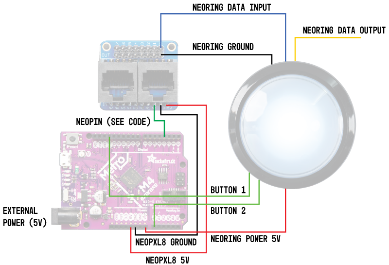

Buttons Interface
=================

## Materials

- [Metro M4](https://www.adafruit.com/product/3382)
- [NeoPixel Ring 24 x 5050 RGBW LEDs w/ Integrated Drivers (Cool White)](https://www.adafruit.com/product/2863)
- [NeoPXL8 Friend](https://www.adafruit.com/product/3975)
- [Massive Archade Button (normally open)](https://www.adafruit.com/product/1187?gclid=EAIaIQobChMIydGU7cea5wIVRpyzCh2zFwFIEAQYAyABEgKD7vD_BwE)
- [5V 10A switching power supply](https://www.adafruit.com/product/658)

## Wiring

The button can be wired as in the diagram below. Note that for the [Metro M4](https://www.adafruit.com/product/3382) board, the [NeoPXL8 Friend](https://www.adafruit.com/product/3975) must be connnected to the board on one of the following ports: 3, 6, 8, 11, A3, MOSI.



## Code Organization

The main logic for the Metro M4 board is in the `src/main.cpp` file. The rest of the code is organized into 3 modules, each with
their respective header in the include/ directory and source file in the src/ directory.

- `shutter_button`: Button logic. Encapsulates the read pin logic, coloring, and publishing functionality for ROS. Depends on the other modules.
- `light_animation`: Animation logic. Encapsulates light "animations", which are simple light behaviors that can be rendered on a given button.
- `light_color`: Utility objects for dealing with colors with the Neopixel library. Used by light_animation.

### Dependencies

- [rosserial v. 0.7.7](https://github.com/ros-drivers/rosserial/tree/0.7.7) - Library for communicating with the metro m4 board through ROS. Included as a submodule.
- Adafruit NeoPixel v. 1.3.4 - Defined in the platformio.ini project config. Gets installed automatically by PlatformIO.
- Adafruit NeoPXL8 v. 1.0.2 - Defined in the platformio.ini project config. Gets installed automatically by PlatformIO.
- Adafruit Zero DMA Library v. 1.0.4 - Defined in the platformio.ini project config. Gets installed automatically by PlatformIO.
- Adafruit DMA neopixel library v. 1.1.1 - Defined in the platformio.ini project config. Gets installed automatically by PlatformIO.

### Quick Start

To get and publish data to the metro M4 from ROS, follow the steps below:

1. Add the shutter_buttons repository to your Catkin workspace. Build your workspace, e.g., with `catkin_make`.

2. Connect the Metro board to a computer over USB (e.g., say that it got connected to the port /dev/ttyACM0). The board should be powered.

3. Start ROS (i.e., run `roscore`) and start the serial receiver

```bash
$ rosrun rosserial_python serial_node.py _port:=/dev/ttyACM0 _baud:=57600
```

4. Check the board is publishing the button(s) state, e.g., through the /button1/state topic:

```bash
$ rostopic echo /button1/state
data: False
---
data: False
---
data: False
```

When the button is pressed, the topic should have the value "data: True".

### Changing a Button's Lights

Each button has two states: `pressed` and `unpressed`. For each state, we can set different light animations to customize the behavior of the button. The available light animations are defined in include/light_animation.h,

- **OFFLIGHTANIMATION (ID=0)** - Turns the LEDs off.
- **SINGLECOLORANIMATION (ID=1)** - Makes the LEDs light up with all the same intensity and color.
- **COLORWIPEANIMATION (ID=2)** - Wipe animation among two colors.
- **COLORWHEELANIMATION (ID=3)** - Rainbow color wheel.

To change the behavior of a button, we can use the `/light_change` service published by the metro m4 code through rosserial_python. For example:

```bash
rosservice call /light_change "{
    button_id: 1, pressed: false, anim_type: 2, intensity: 50,
    color_r: 255, color_g: 255, color_b: 0, color_w: 0,
    bcolor_r: 0, bcolor_g: 0, bcolor_b: 0, bcolor_w: 255}"
```

The attributes of the service request message are:

- **button_id** (uint8): ID of the button that we would like to change, e.g., 1 for button1, 2 for button2 and so on...
- **pressed** (bool): true for changing the pressed state animation; false for changing the unpressed state animation.
- **anim_type** (uint8): type of animation we would like to change (from 0 through 3, according to the IDs above).
- **intensity** (uint8): intensity value for the animation (valid for SINGLECOLORANIMATION, COLORWIPEANIMATION, COLORWHEELANIMATION).
- **color_r** (uint8): red value for the animation's foreground color (valid for SINGLECOLORANIMATION, COLORWIPEANIMATION).
- **color_g** (uint8): green value for the animation's foreground color (valid for SINGLECOLORANIMATION, COLORWIPEANIMATION).
- **color_b** (uint8): blue value for the animation's foreground color (valid for SINGLECOLORANIMATION, COLORWIPEANIMATION).
- **color_w** (uint8): white value for the animation's foreground color (valid for SINGLECOLORANIMATION, COLORWIPEANIMATION).
- **bcolor_r** (uint8): red value for the animation's background color (valid for COLORWIPEANIMATION).
- **bcolor_g** (uint8): green value for the animation's background color (valid for COLORWIPEANIMATION).
- **bcolor_b** (uint8): blue value for the animation's background color (valid for COLORWIPEANIMATION).
- **bcolor_w** (uint8): white value for the animation's background color (valid for COLORWIPEANIMATION).

The service call returns one attribute:

- **result** (bool): true if the service was effectively processed by the metro m4 board; false if there was some error (e.g., invalid request attributes).


## Notes

- When the white LEDs are turn on to the max intensity (255 value in [0,255] range), the lights look a bit shaky. The intensity does not look constant.

- The ros_lib library (inside the lib/ directory) was generated with the command `rosrun rosserial_arduino make_libraries.py lib/`. See [this rosserial_arduino tutorial](http://wiki.ros.org/rosserial_arduino/Tutorials/Arduino%20IDE%20Setup) for more information.
